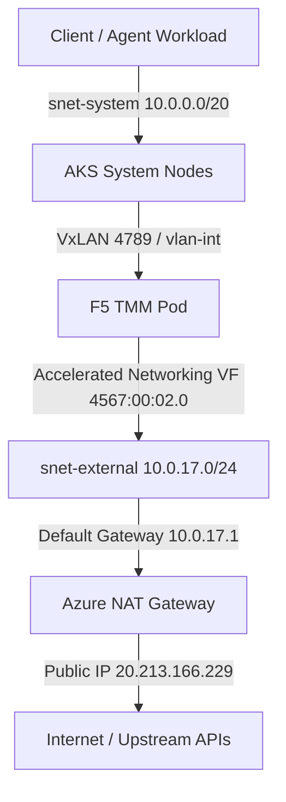

# azrbnkctl


[](https://github.com/JLCode-tech/azrbnkctl/actions/workflows/ci.yml)
[](go.mod)
[](LICENSE)
[](https://github.com/JLCode-tech/azrbnkctl/releases)

A single-binary CLI to provision **F5 BIG-IP Next for Kubernetes (BNK)** on Azure Kubernetes Service (AKS), manage Accelerated Networking virtual functions for high-performance TMM data planes, and validate deployments with built-in end-to-end traffic scenarios.

No Terraform. No host `kubectl`. **One binary, one intent file.**

---

## Contents

- [The `*bnkctl` Family](#the-bnkctl-family)
- [Highlights](#highlights)
- [Pinned Versions](#pinned-versions)
- [Installation](#installation)
- [Prerequisites](#prerequisites)
- [Quick Start](#quick-start)
- [Data-Plane Patterns](#data-plane-patterns)
- [Agentic Workflow](#agentic-workflow)
- [BNK Forge Integration](#bnk-forge-integration)
- [Command Reference](#command-reference)
- [Repository Layout](#repository-layout)
- [Contributing & License](#contributing--license)

---

## The `*bnkctl` Family

`azrbnkctl` is part of the coordinated `*bnkctl` family of single-binary CLIs for deploying and operating F5 BIG-IP Next for Kubernetes across cloud, container, and bare-metal environments:

| Tool | Target Environment | Data Plane & Networking | Upstream Repo |
|---|---|---|---|
| **`azrbnkctl`** | **Azure AKS** | Azure Accelerated Networking (SR-IOV / DPDK), Multi-Networking | [JLCode-tech/azrbnkctl](https://github.com/JLCode-tech/azrbnkctl) |
| **`awsbnkctl`** | **AWS EKS & EC2** | AWS Secondary ENIs (host-device / SR-IOV DPDK), Multus | [JLCode-tech/awsbnkctl](https://github.com/JLCode-tech/awsbnkctl) |
| **`roksbnkctl`** | **IBM Cloud ROKS / OpenShift** | IBM Cloud VPC secondary subnets, Calico / OVN-K | [jgruberf5/roksbnkctl](https://github.com/jgruberf5/roksbnkctl) |
| **`ocibnkctl`** | **Local OCI / k3s Containers** | Docker/Podman container netns virtio demo mode, Anycast BGP | [mwiget/ocibnkctl](https://github.com/mwiget/ocibnkctl) |
| **`gkebnkctl`** | **GCP GKE** | GCP host-device secondary VPC interfaces, Multus | [JLCode-tech/gkebnkctl](https://github.com/JLCode-tech/gkebnkctl) |
| **`bnkctl-index`** | **BNK Forge Catalog** | Curated catalog index packaging all `*bnkctl` runner modules | [mwiget/bnkctl-index](https://github.com/mwiget/bnkctl-index) |

---

## Highlights

- **Deterministic Phased Provisioner** — 27 ordered, idempotent phases driven directly via the Azure Go ARM SDK (`armcontainerservice`, `armnetwork`, `armresources`). Azure resource tags serve as the single source of truth; local state caches accelerate subsequent runs.
- **Embedded Kubernetes Engine (`k`)** — Native `client-go` dynamic Server-Side Apply (SSA) engine providing `get`, `apply`, `describe`, `delete`, `logs`, `exec`, and `port-forward` with zero host `kubectl` dependencies.
- **Automated Node Preparation** — Automatic HugePages allocation (4Gi 2MB HugePages), kernel core dump configuration, and kubelet capacity advertisement.
- **Native Azure Hardware Discovery** — Dynamic discovery of Azure Accelerated Networking SR-IOV virtual functions (`4567:00:02.0`), Subnet Gateways, and Self IPs.
- **Agentic Workflow Built-In** — First-class AI pair-programming support with `azrbnkctl agent [gemini, claude, opencode, cursor]`, append-only operational journaling (`azrbnkctl journal`), and BNK Forge MCP integration.
- **BNK Forge Integration** — Instant one-line cluster registration, project management, and real-time data plane topology visualization with `azrbnkctl forge register`.
- **Cross-Platform Single Binary** — Statically compiled for Linux (amd64, arm64), macOS (Apple Silicon arm64, Intel amd64), and Windows, with SHA-256 verified in-place upgrades (`azrbnkctl self update`).

---

## Pinned Versions

| Component | Pinned Version / Range | Notes |
|---|---|---|
| **BNK** | `2.4.0` (also supports `2.3.x`) | Primary supported release |
| **CNE Release Manifest** | `2.4.0` (Default) | Resolved dynamically from FAR registry |
| **Kubernetes (AKS)** | `1.32` – `1.35` (Default: `1.34.10`) | Preflight gate rejects < 1.32 |
| **Azure Go SDK** | `v6` (`armcontainerservice/v6`, `armnetwork/v6`) | Direct Azure Resource Manager API communication |
| **cert-manager** | `v1.16.1` | Managed via embedded SSA installer |
| **FLO Helm / CRDs** | `v2.30+` / `v2.21+` | Resolved and reconciled dynamically |

---

## Installation

### Option 1: Pre-Built Binary (Recommended)

Download the archive for your OS and architecture from [GitHub Releases](https://github.com/JLCode-tech/azrbnkctl/releases/latest), unpack, and install onto your `PATH`:

```bash
# macOS (Apple Silicon)
curl -fsSL https://github.com/JLCode-tech/azrbnkctl/releases/latest/download/azrbnkctl_darwin_arm64.tar.gz | tar -xz
./azrbnkctl install

# Linux (x86_64)
curl -fsSL https://github.com/JLCode-tech/azrbnkctl/releases/latest/download/azrbnkctl_linux_amd64.tar.gz | tar -xz
./azrbnkctl install
```

Verify installation and upgrade in place at any time:
```bash
azrbnkctl version
azrbnkctl self update
```

### Option 2: Go Install (Go 1.25+)

```bash
go install github.com/JLCode-tech/azrbnkctl/cmd/azrbnkctl@latest
```

### Option 3: Build from Source

```bash
git clone https://github.com/JLCode-tech/azrbnkctl.git
cd azrbnkctl
make build
./bin/azrbnkctl --help
```

---

## Prerequisites

- **Azure Subscription**: Active subscription with permissions for AKS, VNet, NAT Gateway, Public IPs, and NSG creation.
- **Azure CLI (`az`)**: Installed and logged in (`az login`), or environment variables configured (`AZURE_TENANT_ID`, `AZURE_CLIENT_ID`, `AZURE_CLIENT_SECRET`).
- **F5 FAR Registry Credentials**: F5 Automated Registry access token / pull secret (`far-secret`).
- **F5 BNK License JWT**: Valid F5 Next license token.

---

## Quick Start

### 1. Preflight Diagnostics
```bash
azrbnkctl doctor --subscription-id <azure-subscription-id>
```

### 2. Configuration Validation
```bash
azrbnkctl validate cluster.yaml
```

### 3. Provision & Deploy
```bash
# Dry-run execution plan
azrbnkctl up -f cluster.yaml --dry-run

# Live deployment
azrbnkctl up -f cluster.yaml
```

### 4. Day-2 Operations & Verification
```bash
# Embedded kubectl pass-through
azrbnkctl k get pods -A

# Test DNS resolution & latency distribution
azrbnkctl test dns --target f5.com

# Test egress connectivity
azrbnkctl test egress -f cluster.yaml

# Check BNK Forge status
azrbnkctl forge status -f cluster.yaml
```

### 5. Teardown
```bash
# Teardown AKS cluster and managed resources (Resource Group is preserved by default)
azrbnkctl down -f cluster.yaml

# To also delete the Resource Group (e.g. clean dev teardowns)
azrbnkctl down -f cluster.yaml --delete-rg
```


---

## Data-Plane Patterns



---

## Agentic Workflow

`azrbnkctl` provides native tools for AI coding assistants and autonomous operators:

```bash
# Launch AI agent session with context
azrbnkctl agent gemini
azrbnkctl agent claude

# Operational Journaling
azrbnkctl journal add "Provisioned TMM node pool and configured HugePages"
azrbnkctl journal list

# BNK Forge MCP Integration (http://localhost:8081/mcp/)
azrbnkctl forge register -f cluster.yaml
azrbnkctl forge status -f cluster.yaml
```

## BNK Forge Integration

`azrbnkctl forge` (`azrbnkctl bnkforge` alias) connects AKS + BNK 2.4 clusters to **F5 BNK Forge** via MCP (`http://localhost:8081/mcp/`) and REST (`http://localhost:8000`):

```bash
# Register cluster and deploy bnk-forge-agent into f5-utils
azrbnkctl forge register -f cluster.yaml

# Check Forge registration and MCP reachability
azrbnkctl forge status -f cluster.yaml

# Run readiness & BNK 2.4 CRD scan
azrbnkctl forge scan -f cluster.yaml

# Stream live TMM governance and dataplane telemetry
azrbnkctl forge telemetry -f cluster.yaml

# Run aiperf LLM benchmarks from the Azure jumphost VM against the BNK VIP
azrbnkctl forge benchmark -f cluster.yaml --scenarios latency,throughput
```

See [docs/FORGE_INTEGRATION.md](docs/FORGE_INTEGRATION.md) for full configuration and subcommand details.

---

## Command Reference

All 24 top-level commands supported by `azrbnkctl`:

| Command | Description |
| :--- | :--- |
| `azrbnkctl init` | Generate a starter `cluster.yaml` intent file |
| `azrbnkctl validate <cluster.yaml>` | Validate schema, subnet CIDRs, VM sizes, and Kubernetes version gates |
| `azrbnkctl up -f <cluster.yaml>` | Provision Azure VNet, AKS cluster, TMM node pool, and BNK 2.4 stack (27 phases) |
| `azrbnkctl down -f <cluster.yaml>` | Tear down AKS cluster and managed network resources in reverse dependency order |
| `azrbnkctl status -f <cluster.yaml>` | Inspect Azure, AKS, BNK 2.4 (`Infra`, `CNEInstance`, TMM), and Forge status |
| `azrbnkctl logs [tmm\|controller\|cwc\|flo]` | Stream BNK component or TMM governance logs (`--governance`) |
| `azrbnkctl get <resource>` | Shorthand alias for `azrbnkctl k get` |
| `azrbnkctl k <subcommand>` | Embedded `client-go` Kubernetes CLI (`get`, `apply`, `describe`, `delete`, `logs`, `exec`, `port-forward`) |
| `azrbnkctl doctor` | Run Azure preflight checks and 10-point BNK cluster health diagnostics |
| `azrbnkctl test [connectivity\|dns\|egress]` | Run data-plane connectivity, DNS latency, and egress SNAT verification |
| `azrbnkctl scenarios [list\|run\|verify\|clean\|load]` | Deploy, verify, load-test, and clean end-to-end BNK 2.4 traffic & AI scenarios (`clean --all`) |
| `azrbnkctl benchmark` | Run `aiperf` LLM benchmarks from the Azure jumphost VM against BNK VIPs |
| `azrbnkctl bnk [status\|heal\|upgrade\|migrate-2.4\|mcp-session\|troubleshoot]` | Day-2 BNK 2.4 operations, self-healing (`--only controller-identity`), and 2.3→2.4 migration |
| `azrbnkctl forge [register\|status\|unregister\|cleanup\|template\|scan\|telemetry\|benchmark]` | Manage BNK Forge cluster registration, templates, scanning, telemetry, and benchmarks |
| `azrbnkctl bnkforge` | Backward-compatibility alias for `azrbnkctl forge` |
| `azrbnkctl topology` | Discover and render live AKS node, SR-IOV VF, and BNK TMM topology |
| `azrbnkctl manifest [list\|show\|probe]` | Inspect embedded BNK release manifests and probe FAR registry artifacts |
| `azrbnkctl journal [add\|list\|show\|path\|clear]` | Manage the append-only operational journal |
| `azrbnkctl agent [claude\|gemini\|opencode\|cursor]` | Launch an AI coding assistant preloaded with cluster context |
| `azrbnkctl install [--dir <path>] [--force]` | Install the `azrbnkctl` binary into `$PATH` (`/usr/local/bin` or `~/.local/bin`) |
| `azrbnkctl self [info\|update]` | Inspect binary metadata or perform SHA-256 verified in-place release updates |
| `azrbnkctl version` | Print version, git commit, and build timestamp |
| `azrbnkctl completion [bash\|zsh\|fish\|powershell]` | Generate shell completion scripts |
| `azrbnkctl help [command]` | Display help for any command |

---

## Repository Layout

```text
azrbnkctl/
├── .github/                 # GitHub Actions CI/CD workflows and Dependabot
├── cmd/                     # CLI entrypoint (azrbnkctl)
├── internal/
│   ├── azure/               # Azure ARM SDK clients and 27 lifecycle phases
│   ├── bnkforge/            # BNK Forge MCP & REST registration logic
│   ├── cli/                 # Cobra CLI commands (24 top-level commands)
│   ├── doctor/              # Azure subscription and cluster preflight checks
│   ├── forge/               # BNK Forge telemetry, scan, and benchmark client
│   ├── intent/              # cluster.yaml schema parsing and validation
│   ├── journal/             # Append-only operational journal
│   ├── k8s/                 # Dynamic client-go SSA manifests, BNK 2.4 templates, and migration
│   ├── netcalc/             # IPv4/IPv6 CIDR calculations
│   ├── self/                # SHA-256 verified archive extraction and in-place self-update
│   └── test/                # Network and DNS latency test runners
├── docs/                    # Architecture, phase specifications, and runbooks
├── examples/                # Declarative cluster definitions (dual-interface, external-only, agentfoundry-demo)
├── hack/                    # 11-gate local CI runner (ci-local.sh)
├── scripts/                 # Security and pre-commit automation scripts
├── tools/                   # BNK Forge pack metadata
├── Makefile                 # Development build and test automation targets
└── cluster.yaml             # Default cluster definition
```

---

## Contributing & License

Contributions are welcome! Please review [CONTRIBUTING.md](CONTRIBUTING.md) before submitting Pull Requests.

Licensed under the [MIT License](LICENSE).
