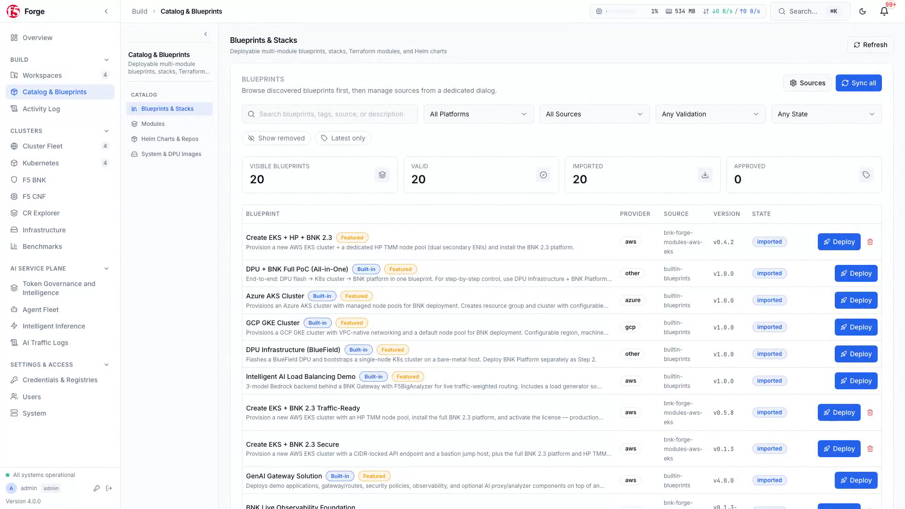

# `azrbnkctl` — Azure AKS F5 BIG-IP Next for Kubernetes (BNK) Engine

[](go.mod)
[](LICENSE)
[](#the-bnkctl-multi-cloud-family)

`azrbnkctl` is a **pure-Go lifecycle and validation CLI** for deploying, operating, upgrading, benchmarking, and tearing down **F5 BIG-IP Next for Kubernetes (BNK)** and **F5 BNK AI Service Plane** estates on **Azure Kubernetes Service (AKS)** — with native integration into [**F5 BNK Forge**](https://github.com/JLCode-tech/bnk-forge).

> **Preferred Multi-Cloud CLI**: [**`bnkctl`**](https://github.com/JLCode-tech/bnkctl) is the **preferred unified multi-cloud CLI** for deploying F5 BNK across **AWS EKS**, **Azure AKS**, and **Google Cloud GKE** from a single binary. `azrbnkctl` is the standalone Azure-pinned CLI in the same family and shares the same engine, command surface, and declarative `cluster.yaml` model.


---

## Why `azrbnkctl`?

Deploying a **BIG-IP Next for Kubernetes (BNK)** and **F5 BNK AI Service Plane** on Azure AKS traditionally requires stitching together cloud-specific Terraform modules, CNI plumbing, secondary VMSS NIC attachments, Accelerated Networking device plugins, Helm charts, and post-install reconciliations.

`azrbnkctl` replaces that complexity with **one declarative `cluster.yaml` intent file** and **one pure-Go engine**:

- **Part of the `bnkctl` Family**: Shares the same architecture and CLI experience as [**`bnkctl`**](https://github.com/JLCode-tech/bnkctl) (the preferred unified multi-cloud CLI), [**`awsbnkctl`**](https://github.com/JLCode-tech/awsbnkctl), and [**`gkebnkctl`**](https://github.com/JLCode-tech/gkebnkctl).
- **Pure Azure & Kubernetes SDKs**: Provisions Resource Groups, VNets, system and TMM node pools, Accelerated Networking secondary NICs (`dual-interface`), NSGs, NAT Gateways, Azure Load Balancers, and AKS clusters directly via `azure-sdk-for-go`, `client-go`, and the Helm v3 Go SDK.
- **Version-Aware BNK Release Catalog**: Built-in support for BNK **2.3.x** (`legacy-spk`), **2.4.0**, **2.4.1**, and **future release** (`gateway-infra`), including automatic release-quirk self-healing (`azrbnkctl heal`) and cross-train migration (`azrbnkctl migrate`). See the [F5 BIG-IP Next for Kubernetes CloudDocs](https://clouddocs.f5.com/bigip-next-for-kubernetes/latest/overview.html) for full platform documentation.
- **Turnkey BNK Forge & F5 BNK AI Service Plane**: Automatically registers clusters with [**F5 BNK Forge**](https://github.com/JLCode-tech/bnk-forge) during `azrbnkctl up`, seeds AI Token Governance and Smart LLM Routing for **Azure AI Foundry**, and cleans up on `azrbnkctl down`.
- **Zero-Leak Teardown**: Deterministic reverse-dependency teardown (`azrbnkctl down`) strips stuck Kubernetes finalizers, removes cloud load balancers and secondary NICs, deletes the AKS cluster and Resource Group underlay, and unregisters from [BNK Forge](https://github.com/JLCode-tech/bnk-forge).

---

## The `bnkctl` Multi-Cloud Family

[**`bnkctl`**](https://github.com/JLCode-tech/bnkctl) is the preferred unified CLI across all three hyperscalers, while `awsbnkctl`, `azrbnkctl`, and `gkebnkctl` provide standalone single-cloud binaries:

| CLI & Repository | Status | Target Cloud | Default Underlay & Dataplane Architecture |
| :--- | :--- | :--- | :--- |
| [**`bnkctl`**](https://github.com/JLCode-tech/bnkctl) | **Preferred (Unified)** | **AWS, Azure, GCP** | Auto-detects cloud provider from `cluster.yaml` (`apiVersion` or `cloud.provider`) or `--cloud aws\|azure\|gcp`. |
| [**`awsbnkctl`**](https://github.com/JLCode-tech/awsbnkctl) | Single-Cloud (AWS) | **AWS EKS** | VPC + Public/Private/DataPath Subnets (including AWS Local Zones), Multus + `host-device` / SR-IOV secondary ENIs, AWS Route Server BGP peering. |
| [**`azrbnkctl`**](https://github.com/JLCode-tech/azrbnkctl) | Single-Cloud (Azure) | **Azure AKS** | VNet + System & TMM Node Pools, Accelerated Networking (`dual-interface`), dynamic secondary NIC attachment, VXLAN egress / L4 load balancing. |
| [**`gkebnkctl`**](https://github.com/JLCode-tech/gkebnkctl) | Single-Cloud (GCP) | **GCP GKE** | Multi-VPC (`main`, `external`, `internal`) with Jumbo Frames (MTU 8896), GKE multi-network pod attachments (`virtio`), Cloud NAT & IAP jumphost. |

---

## What You Can Build with `azrbnkctl` + [BNK Forge](https://github.com/JLCode-tech/bnk-forge)

When `forge.enabled: true` is set in your `cluster.yaml`, `azrbnkctl up` automatically bridges your Azure AKS cluster into [**BNK Forge**](https://github.com/JLCode-tech/bnk-forge) — giving you a visual control plane for BNK lifecycle, security policy authoring, AI token governance, and LLM benchmarking.

### 1. Unified Multi-Cloud Cluster Fleet & Blueprints Catalog

As soon as `azrbnkctl up` completes Forge registration, your Azure AKS cluster appears in the [**BNK Forge**](https://github.com/JLCode-tech/bnk-forge) **Cluster Fleet** alongside your multi-cloud estate with live data-plane telemetry, active listeners, L4/L7 routes, and one-click deployable **Blueprints**.




### 2. Visual Network Security & Traffic Policy Management

Author, visualize, and enforce L4/L7 traffic routing, carrier-grade network translation, DNS delivery, and zero-trust security policies across your Kubernetes clusters from a single visual interface or declaratively via `azrbnkctl`. For complete details on F5 BIG-IP Next for Kubernetes traffic and security capabilities, see the [F5 BIG-IP Next for Kubernetes CloudDocs](https://clouddocs.f5.com/bigip-next-for-kubernetes/latest/overview.html).


### 3. F5 BNK AI Service Plane: Token Governance & Data Guardrails

Deliver enterprise-grade AI traffic governance on Azure with real-time token accounting, budget and rate enforcement, sensitive data (PII/DLP) guardrails, and prompt-injection protection managed through [**BNK Forge**](https://github.com/JLCode-tech/bnk-forge). Learn more about F5's cloud-native data plane and AI traffic capabilities in the [F5 BIG-IP Next for Kubernetes CloudDocs](https://clouddocs.f5.com/bigip-next-for-kubernetes/latest/overview.html).


### 4. Smart LLM Router Fleet for Azure AI Foundry

Route agentic and inference traffic across primary and fallback foundation models in **Azure AI Foundry** (GPT-4o / GPT-4.1 / o3-mini) — complete with Model Context Protocol (MCP) tool security and weighted failover:


### 5. Automated GenAI & Dataplane Benchmarking (`aiperf` + 15 Built-in Scenarios)

Compare throughput, Time-to-First-Token (TTFT), Inter-Token Latency (ITL), and token-rate enforcement across **F5 BNK + F5 GAIE**, Envoy, HAProxy, and `llm-d` Router, or run any of the 15 built-in Kubernetes validation scenarios (`azrbnkctl scenarios run`):


### 6. AI-Assisted Day-2 Operations via 153 MCP Server Tools

Every cluster registered by `azrbnkctl` can be inspected, diagnosed, and operated through [BNK Forge](https://github.com/JLCode-tech/bnk-forge)'s built-in **Model Context Protocol (MCP) Server**, exposing 153 structured tools for AI assistants and automation pipelines:


---

## Quickstart

### Prerequisites

1. **Go 1.26+** (to build from source) or a pre-built release binary from [GitHub Releases](https://github.com/JLCode-tech/azrbnkctl/releases).
2. **F5 BIG-IP Next for Kubernetes License & Registry Access** (gitignored locally; never committed):
   - Follow the [F5 BIG-IP Next for Kubernetes CloudDocs](https://clouddocs.f5.com/bigip-next-for-kubernetes/latest/overview.html) to obtain your F5 subscription JWT (`license.jwt`) and configure F5 Artifact Registry (`repo.f5.com`) pull credentials.
3. **Azure Credentials**:
   - Azure CLI session (`az login`) or Service Principal environment variables (`AZURE_SUBSCRIPTION_ID`, `AZURE_TENANT_ID`, `AZURE_CLIENT_ID`, `AZURE_CLIENT_SECRET`).

### 1. Build the CLI

```bash
git clone https://github.com/JLCode-tech/azrbnkctl.git
cd azrbnkctl
go build -o ./azrbnkctl ./cmd/azrbnkctl
```

### 2. Validate & Dry-Run Any Example Offline

You can validate any `cluster.yaml` and preview the full Azure underlay + BNK overlay execution plan without touching live Azure APIs:

```bash
# Azure AKS + Azure AI Foundry + F5 BNK AI Service Plane (2.4.1)
./azrbnkctl validate -c examples/agentfoundry-demo/cluster.yaml
./azrbnkctl up -c examples/agentfoundry-demo/cluster.yaml --dry-run

# Dual-Interface Accelerated Networking AKS Blueprint
./azrbnkctl validate -c examples/dual-interface/cluster.yaml
./azrbnkctl up -c examples/dual-interface/cluster.yaml --dry-run
```

### 3. Deploy End-to-End (`azrbnkctl up`)

```bash
# Deploy using azrbnkctl (or use the preferred unified `bnkctl up -c ...`)
./azrbnkctl up -c examples/agentfoundry-demo/cluster.yaml
```

### 4. Inspect, Heal, Benchmark & Teardown

```bash
# Check Azure underlay, TMM dataplane, BNK release profile, and active quirks
./azrbnkctl status -c examples/agentfoundry-demo/cluster.yaml

# Run BNK release-quirk self-healing and route pool resync
./azrbnkctl heal -c examples/agentfoundry-demo/cluster.yaml
./azrbnkctl bnk resync -c examples/agentfoundry-demo/cluster.yaml

# Verify BNK Forge registration & F5 BNK AI Service Plane governance readiness
./azrbnkctl forge status -c examples/agentfoundry-demo/cluster.yaml
./azrbnkctl forge governance overview -c examples/agentfoundry-demo/cluster.yaml

# Run validation scenarios (L4 TCP/UDP, gRPC, HTTP routing, Egress SNAT, AI Token Counting)
./azrbnkctl scenarios list
./azrbnkctl scenarios run http-routing-e2e -c examples/agentfoundry-demo/cluster.yaml

# Tear down all Azure & cluster resources cleanly with zero leaked NICs/VNets/Disks
./azrbnkctl down -c examples/agentfoundry-demo/cluster.yaml
```

---

## Command Reference

| Command | Description |
| :--- | :--- |
| `azrbnkctl up` | Provision Azure underlay (Resource Group, VNet, AKS cluster, secondary NICs, Load Balancers) and deploy the BNK overlay stack + [BNK Forge](https://github.com/JLCode-tech/bnk-forge) registration |
| `azrbnkctl down` | Tear down BNK overlay, strip stuck finalizers, unregister from [BNK Forge](https://github.com/JLCode-tech/bnk-forge), and destroy all Azure underlay resources |
| `azrbnkctl status` | Inspect Azure underlay state, BNK release train/profile, TMM dataplane readiness, and active release quirks |
| `azrbnkctl validate` | Validate `cluster.yaml` intent and dry-run render all BNK overlay manifests |
| `azrbnkctl doctor` | Verify local prerequisites, Azure credentials, registry pull credentials, and subscription JWT validity |
| `azrbnkctl heal` | Run idempotent BNK self-healing and version-specific quirk reconciliations |
| `azrbnkctl upgrade` | Upgrade BNK overlay in-place within the same architectural release train |
| `azrbnkctl migrate` | Migrate BNK overlay across architectural release boundaries (e.g., `2.3.x legacy-spk` -> `2.4.x/future gateway-infra`) |
| `azrbnkctl bnk {status,scan,heal,resync,upgrade,migrate}` | Granular BNK overlay inspection, MCP endpoint scanning, and pool-member resynchronization |
| `azrbnkctl forge {register,unregister,status,governance}` | Register/unregister clusters with [BNK Forge](https://github.com/JLCode-tech/bnk-forge) and manage F5 BNK AI Service Plane governance |
| `azrbnkctl scenarios {list,show,run}` | List, inspect, and execute 15 built-in BNK L4/L7, egress, and GenAI validation scenarios |
| `azrbnkctl test {connectivity,dns}` | Execute TCP/UDP VIP connectivity and DNS probes from the cluster jumphost or probe pod |
| `azrbnkctl genai parse` | Parse `aiperf` benchmark artifacts into structured [BNK Forge](https://github.com/JLCode-tech/bnk-forge) GenAI telemetry |
| `azrbnkctl k` | In-process Kubernetes `client-go` operations with automatic cluster template variable rendering |
| `azrbnkctl topology` | Render cluster network and TMM dataplane interface topology |

---

## Example Azure Blueprints (`examples/`)

| Directory | Region / Mode | Architecture & Use Case |
| :--- | :--- | :--- |
| [`examples/agentfoundry-demo/`](examples/agentfoundry-demo/) | **Azure AKS (`australiaeast`)** | Dual-Interface Accelerated Networking AKS + F5 BNK AI Service Plane (2.4.1) + Azure AI Foundry + MCP Token Shipper |
| [`examples/dual-interface/`](examples/dual-interface/) | **Azure AKS (`dual-interface`)** | Secondary VMSS NICs with Accelerated Networking VF passthrough and Multus `host-device` |
| [`examples/external-only/`](examples/external-only/) | **Azure AKS (`external-only`)** | Single data-plane subnet topology with VXLAN internal pod routing |
| [`examples/full-cluster/`](examples/full-cluster/) | **Azure AKS** | Full multi-subnet AKS cluster with ingress and egress data-plane validation |
| [`examples/egress/`](examples/egress/) | **Azure AKS** | Outbound SNAT, VXLAN egress, and deterministic source-IP validation |

---

## Documentation Index

- [**Unified Multi-Cloud CLI (`JLCode-tech/bnkctl`)**](https://github.com/JLCode-tech/bnkctl) — The preferred unified multi-cloud CLI for AWS EKS, Azure AKS, and Google Cloud GKE.
- [**Architecture & Design (`docs/ARCHITECTURE.md`)**](docs/ARCHITECTURE.md) — Azure AKS underlay, Accelerated Networking secondary NIC plumbing, and BNK overlay architecture.
- [**BNK Forge & F5 BNK AI Service Plane Integration (`docs/FORGE_INTEGRATION.md`)**](docs/FORGE_INTEGRATION.md) — Visual walkthrough of [BNK Forge](https://github.com/JLCode-tech/bnk-forge) cluster registration, policy building, AI token governance, and Smart LLM Routing.
- [**Commands Reference (`docs/COMMANDS.md`)**](docs/COMMANDS.md) & [**Validation Scenarios (`docs/SCENARIOS.md`)**](docs/SCENARIOS.md) — Detailed CLI flags and 15 built-in validation scenarios.
- [**F5 BIG-IP Next for Kubernetes CloudDocs**](https://clouddocs.f5.com/bigip-next-for-kubernetes/latest/overview.html) — Official F5 product documentation, architecture guides, and prerequisite setup.

---

## License

Released under the [MIT License](LICENSE).
