# Automated Validation Scenarios & Day-2 Operations

`azrbnkctl` includes a built-in suite of 15 automated validation scenarios, curated demonstrations, and Day-2 testing tools for live Azure Kubernetes Service (AKS) and Azure Local / Edge Zone deployments of F5 BIG-IP Next for Kubernetes (BNK).

Scenarios run against any cluster provisioned by `azrbnkctl up`, verifying the control plane, Gateway API custom resources, and the wire-level data plane through the F5 Traffic Management Microkernel (TMM).

---

## Running Scenarios & Demos

### Scenario Commands
```bash
# List all 15 validation scenarios and their rating / dependencies
azrbnkctl scenarios list

# Render manifests locally without modifying the cluster
azrbnkctl scenarios run http-routing-e2e -f cluster.yaml --dry-run

# Run a single scenario against your cluster
azrbnkctl scenarios run http-routing-e2e -f cluster.yaml

# Run every registered scenario in topologically sorted order
azrbnkctl scenarios run --all -f cluster.yaml

# Clean up scenario resources after testing
azrbnkctl scenarios clean http-routing-e2e -f cluster.yaml
azrbnkctl scenarios clean --all -f cluster.yaml
```

### Curated Demos
```bash
# List available interactive and protocol demos
azrbnkctl demo list

# Run the HTTP/2 or Diameter protocol walkthrough
azrbnkctl demo run http2 -f cluster.yaml
azrbnkctl demo run diameter -f cluster.yaml

# Clean up demo workloads
azrbnkctl demo clean http2 -f cluster.yaml
```

### Day-2 Diagnostic Probes
```bash
# Probe DNS resolution against upstream or internal resolvers
azrbnkctl test dns --target f5.com --server 10.0.0.10:53 --iterations 5

# Test TCP/UDP reachability to any internal or external endpoint
azrbnkctl test connectivity --target 10.0.17.100:80 --proto tcp --count 3

# Verify egress forwarding and Automap SNAT through TMM
azrbnkctl test egress -f cluster.yaml
```

---

## 1. Ingress & L7 Protocol Scenarios

### `http-routing-e2e` (VIP `.100`)
- **Objective**: Validates core HTTP/1.1 traffic routing through the F5 BNK Gateway API data plane.
- **Traffic Path**: Client / Jumphost $\to$ TMM VIP:80 (`10.0.17.100`) $\to$ Gateway $\to$ HTTPRoute $\to$ NGINX backend pod.
- **Assertions**: Backend Deployment Available, Gateway Programmed, HTTPRoute Accepted, 5/5 curls return HTTP 200 with matching body marker.
- **Rating**: **Green**.

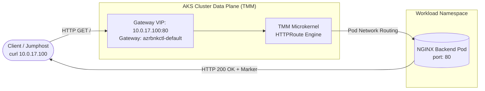

---

### `http-traffic-split` (VIP `.101`)
- **Objective**: Validates weighted canary and traffic splitting across multiple backend services using Gateway API `HTTPRoute` weights.
- **Traffic Path**: Client curls VIP:80 (`10.0.17.101`) $\to$ TMM distributes traffic according to defined weight ratio (e.g., 80% Service A, 20% Service B).
- **Assertions**: Deployments Available, Gateway Programmed, HTTPRoute Accepted, distribution of 100 requests matches weight tolerances.
- **Rating**: **Green**.

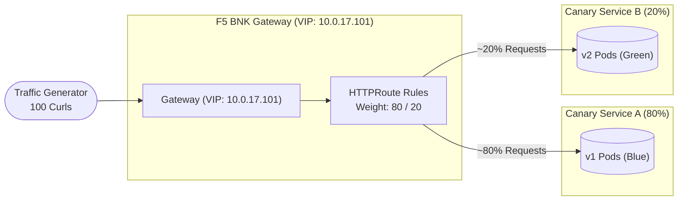

---

### `grpc-loadbalance` (VIP `.108`)
- **Objective**: Validates HTTP/2-based gRPC unary and streaming RPC multiplexing over TMM.
- **Traffic Path**: gRPC client (`grpcurl`) $\to$ TMM L4/L7 listener (:50052) $\to$ `grpcbin` backend.
- **Assertions**: Control plane Ready, Gateway Programmed, `L4Route`/`GRPCRoute` Accepted, RPC status code 0 (OK).
- **Rating**: **Amber** (control plane verified; green requires `grpcurl` probe from jumphost).

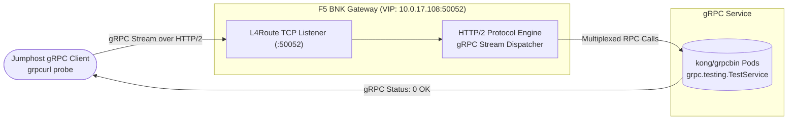

---

## 2. L4 Protocol & Transport Scenarios

### `tcp-l4-loadbalance` (VIP `.106`)
- **Objective**: Validates raw L4 TCP stream proxying via `L4Route` with round-robin flow balancing.
- **Traffic Path**: Client TCP traffic $\to$ `L4Route` VIP:8080 (`10.0.17.106`) $\to$ marker backends.
- **Assertions**: Deployments Available, Gateway Programmed, `L4Route` Accepted, both backends receive traffic.
- **Rating**: **Green**.

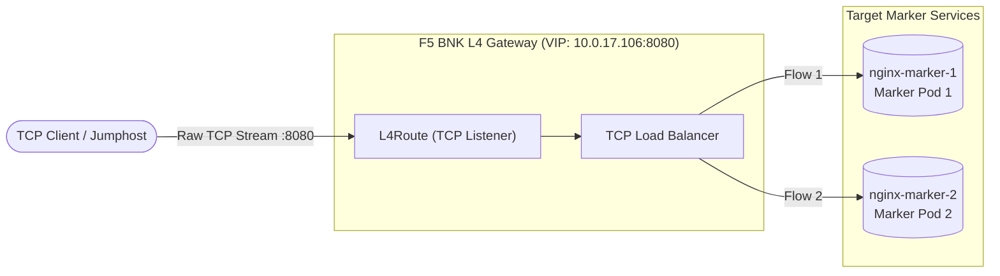

---

### `udp-l4-loadbalance` (VIP `.107`)
- **Objective**: Validates stateless UDP datagram routing and 5-tuple hash distribution.
- **Traffic Path**: UDP client $\to$ TMM L4 VIP:5353 (`10.0.17.107`) $\to$ UDP echo servers.
- **Assertions**: Deployments Available, Gateway Programmed, `L4Route` Accepted.
- **Rating**: **Amber** (control plane verified; data path requires UDP echo client).

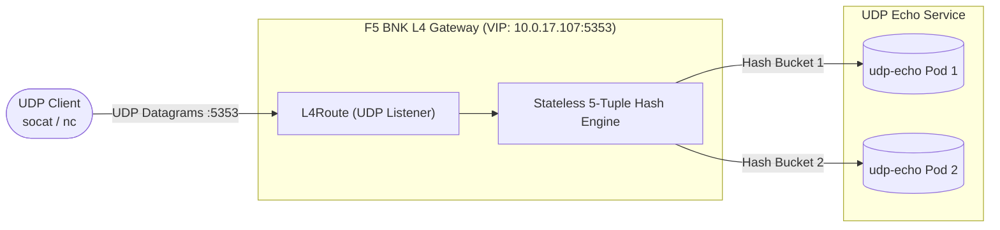

---

### `proxy-protocol-l4` (VIP `.103`)
- **Objective**: Validates PROXY protocol v1 header injection via an `F5BigCneIrule` + `NetPolicy` on a TCP listener.
- **Traffic Path**: Client $\to$ TMM VIP:80 (`10.0.17.103`) $\to$ Backend pod with proxy protocol decoding enabled.
- **Assertions**: Backend echoes `$proxy_protocol_addr`, matching the client's source IP.
- **Rating**: **Green**.

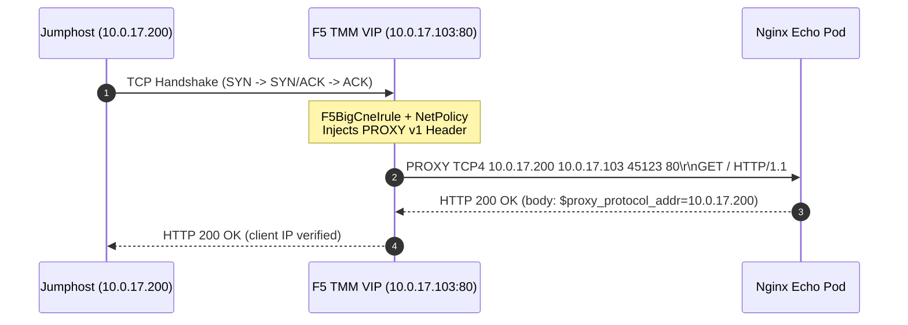

---

## 3. Hybrid & Multi-Tenancy Scenarios

### `external-resource-pool` (VIP `.102`)
- **Objective**: Validates BNK routing traffic to external endpoints outside the Kubernetes cluster (e.g. Azure Virtual Machines, Azure SQL Managed Instances, or on-premise appliances).
- **Traffic Path**: Client $\to$ TMM VIP (`10.0.17.102`) $\to$ External IP target outside AKS pod CIDR.
- **Assertions**: Successful response proxying from non-cluster IP targets.
- **Rating**: **Green**.

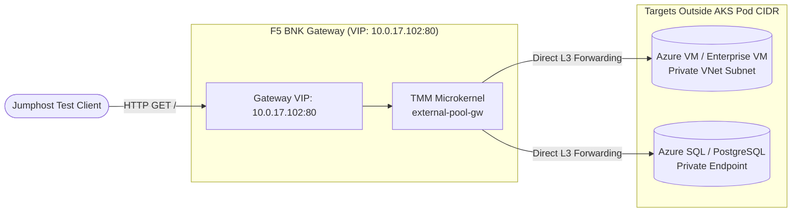

---

### `cluster-wide-watch` (CWC) (VIP `.105`)
- **Objective**: Validates `ClusterWideWatch` CR for multi-tenant cross-namespace routing without full cluster-admin rights in each namespace.
- **Traffic Path**: Client $\to$ TMM VIP (`10.0.17.105`) $\to$ backend in a dynamically provisioned namespace created after BNK was installed.
- **Assertions**: Tenant Deployment Available, Gateway Programmed, HTTPRoute Accepted, curl with `Host: cwatch.azrbnkctl.local` returns HTTP 200.
- **Rating**: **Green**.

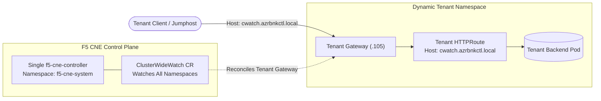

---

### `cwc-admin-access` (In-Cluster)
- **Objective**: Validates that CWC administrative and licensing endpoints enforce mTLS client certs and Bearer tokens.
- **Traffic Path**: In-cluster probe Pod $\to$ CWC HTTPS management endpoints.
- **Assertions**: Authenticated request accepted; missing token returns 401 Unauthorized; invalid token returns 403 Forbidden.
- **Rating**: **Green**.

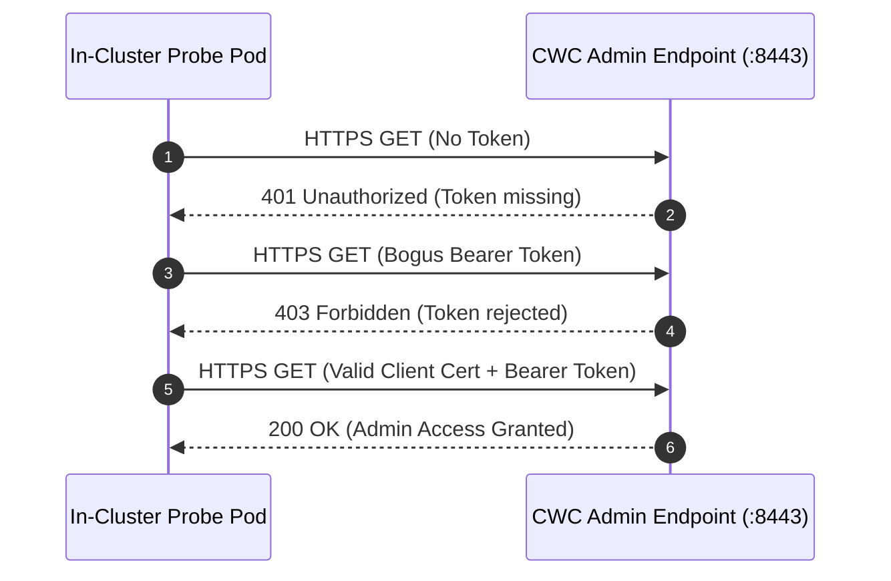

---

### `multi-vip` (VIPs `.115`, `.116`, `.117`)
- **Objective**: Validates binding and processing traffic across multiple distinct VIPs on the same secondary Accelerated Networking interface.
- **Traffic Path**: Simultaneous curls to VIP 1 (`10.0.17.115`, App A) and VIP 2 (`10.0.17.116`, App B).
- **Assertions**: Complete namespace isolation and independent service responses for each VIP.
- **Rating**: **Green**.

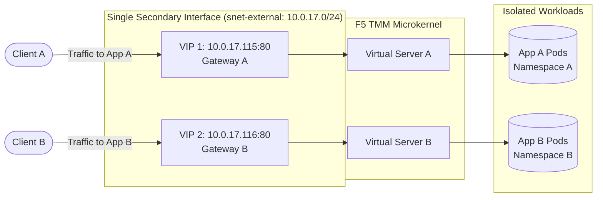

---

## 4. AI Gateway Scenarios

### `ai-token-counting` (VIP `.104`)
- **Objective**: Validates AI Gateway LLM token measurement, token bucket quota enforcement, and rate-limiting.
- **Traffic Path**: Client HTTP POST with completions payload $\to$ TMM AI Gateway (`10.0.17.104`) $\to$ Model endpoint.
- **Assertions**: Control plane Ready, Gateway Programmed, HTTPRoute Accepted, `k8s.f5.com/ai-token-counting` annotation active. Returns HTTP 503 on quota overload.
- **Rating**: **Amber** (control plane verified; data path requires live or simulated LLM backend).

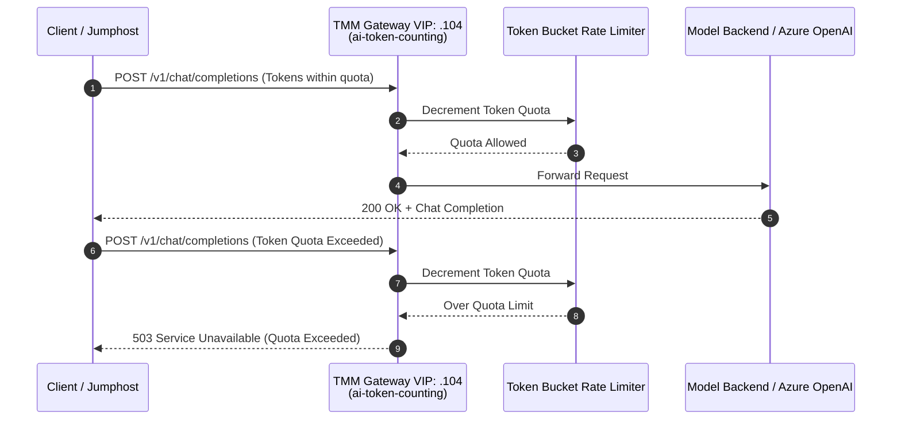

---

### `ai-semantic-cache` (VIP `.109`)
- **Objective**: Validates semantic similarity prompt caching to reduce LLM latency and compute costs.
- **Traffic Path**: First prompt POST $\to$ Cache miss (backend computed); Second semantically equivalent prompt $\to$ Cache hit (TMM cached response).
- **Assertions**: Control plane Ready, Gateway Programmed, HTTPRoute Accepted, second request completes with high cache speedup (>10x).
- **Rating**: **Amber** (control plane verified; data path requires ModelCache backend).

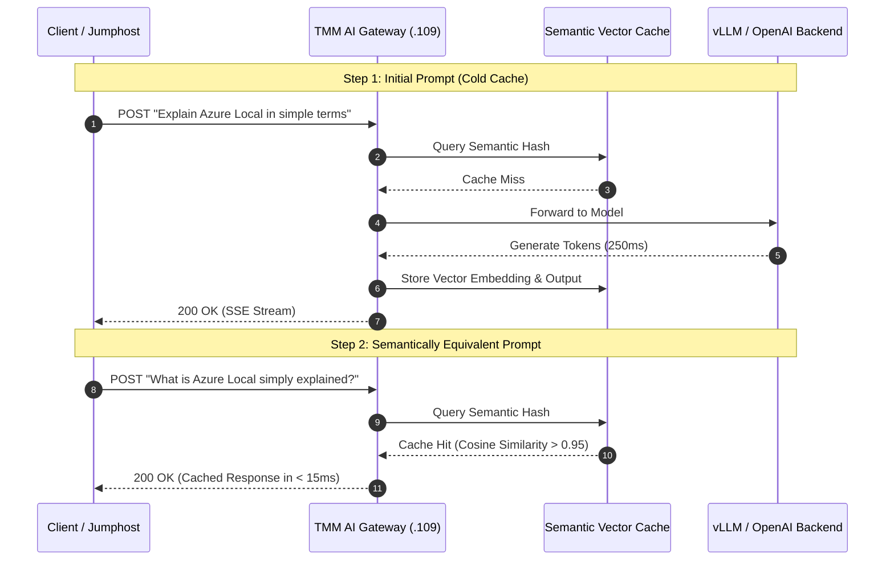

---

### `ai-inference-e2e` (VIP `.112`)
- **Objective**: Validates end-to-end LLM inference streaming through BNK (vLLM on GPU node pool or `llm-d-inference-sim` on CPU).
- **Traffic Path**: Client `POST /v1/chat/completions` with `stream=true` $\to$ TMM VIP (`10.0.17.112`) $\to$ Model inference engine.
- **Assertions**: Inference Deployment Available, Gateway Programmed, HTTPRoute Accepted, HTTP 200 with Server-Sent Events (SSE) framing (`data:` chunks and `[DONE]` terminator).
- **Rating**: **Green** (with real GPU node pool or `--synthetic`).

```mermaid
flowchart LR
    Client([Jumphost Test Client<br/>aiperf Engine])

    subgraph Gateway["F5 BNK AI Gateway (VIP: 10.0.17.112:80)"]
        direction TB
        VIP["Gateway VIP: 10.0.17.112:80<br/>Host: azrbnkctl-aiinference.local"]
        TMM["TMM Microkernel<br/>HTTPRoute: scn-aiinference-route"]
        VIP --> TMM
    end

    subgraph InferenceNodes["Inference Worker Group"]
        Model[("vLLM / Simulator<br/>meta-llama/Llama-3-8B-Instruct")]
    end

    Client -->|POST /v1/chat/completions (stream=true)| VIP
    TMM -->|Balanced Inference Stream| Model
    Model -->|SSE Stream: data: {...}| Client
```

---

## 5. Security & Diagnostics Scenarios

### `egress-snat`
- **Objective**: Validates outbound Source NAT (SNAT) and egress firewall inspection through TMM.
- **Traffic Path**: Workload Pod $\to$ Node routing policy $\to$ TMM (`internal` / `external`) $\to$ AUTOMAP SNAT to external self-IP $\to$ Azure NAT Gateway $\to$ Internet.
- **Assertions**: Client Pod Ready, `GatewaySettings` Accepted, `EgressGateway` Programmed, outbound curls increment TMM egress connection counters.
- **Rating**: **Green**.

```mermaid
flowchart LR
    subgraph Pods["AKS Worker Node Pod Network"]
        ClientPod[("Workload Pod<br/>(Selected Namespace)")]
        Router["Node Routing Policy"]
        ClientPod --> Router
    end

    subgraph BNK["F5 BNK Data Plane (TMM)"]
        Tunnel["TMM Data Plane Interface<br/>(internal / external)"]
        SNAT["EgressGateway & AUTOMAP<br/>SNAT Engine"]
        SelfIP["External Self-IP<br/>(10.0.17.224 - .254)"]
        Tunnel --> SNAT --> SelfIP
    end

    subgraph Egress["Azure Network Egress"]
        NAT["Azure NAT Gateway<br/>(snet-public: 10.0.16.0/28)"]
        Internet([External SaaS API / Registry])
        NAT --> Internet
    end

    Router -->|Outbound Egress Traffic| Tunnel
    Router -.->|Intra-VNet Traffic (Bypasses TMM)| LocalVNet[("Local VNet Resources")]
    SelfIP --> NAT
```

---

### `core-file-collection`
- **Objective**: Validates BNK's core-dump collection infrastructure (`spec.coreCollection.enabled`).
- **Verification Method**: K8s API polling: `CoreMond` CR exists, `f5-coremond` DaemonSet is Ready, `f5-tmm` carries host crash volume mounts.
- **Note**: Run this scenario **last** as FLO rolling TMM to add crash mounts briefly restarts the data plane.
- **Rating**: **Green**.

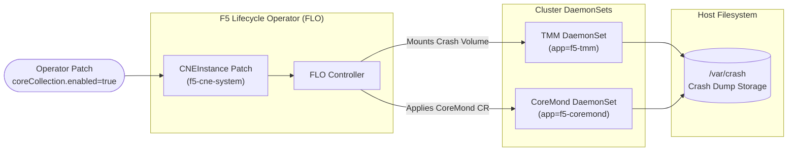

---

## 6. Curated Demonstrations & Walkthroughs

### `agentfoundry-demo` — AI Agent Tool Call Governance (VIP `.150`)
- **Objective**: Demonstrates governing generative AI agent tool calls using F5 BNK. An **Azure AI Foundry** (or Azure OpenAI) agent making Model Context Protocol (MCP) tool calls is authenticated, rate-limited, firewall-checked, and logged in real-time.
- **Location**: `examples/agentfoundry-demo/`
- **Traffic Path**: Azure AI Foundry Agent $\to$ Private VNet $\to$ BNK Gateway VIP (`10.0.17.150:80/443`) $\to$ FastMCP Tool Pod (`forecast`, `get_account_balance`).

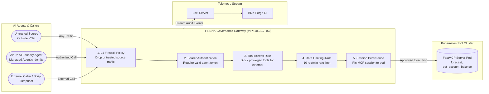

---

### `diameter` Demo (VIP `.110`)
- **Objective**: Demonstrates carrier-grade telecom Diameter protocol (RFC 6733) L4 proxying over TCP.
- **Traffic Path**: Client Python script (`diameter_client.py`) $\to$ TMM L4 Gateway VIP:3868 (`10.0.17.110`) $\to$ `diameter-responder` pod.
- **Validation**: Completes full Capabilities Exchange Request (CER) $\to$ Capabilities Exchange Answer (CEA) handshake and asserts `Result-Code=2001 (DIAMETER_SUCCESS)`.

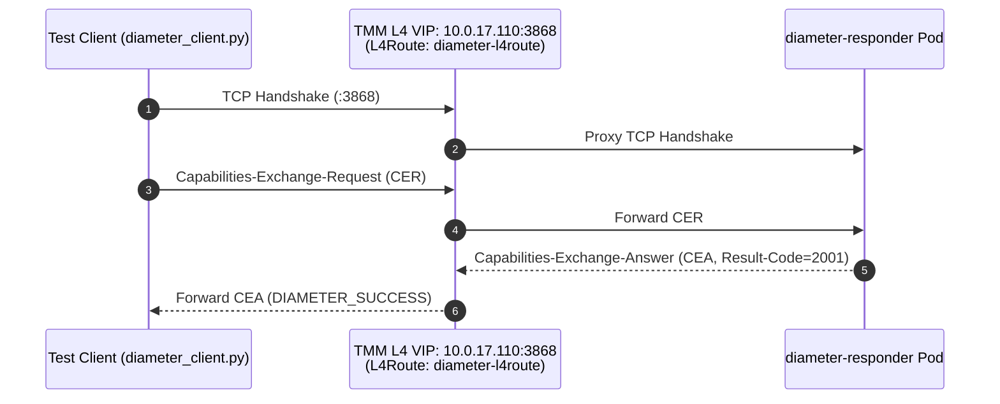

---

### `http2` Demo (VIP `.111`)
- **Objective**: Demonstrates end-to-end HTTP/2 multiplexing (h2c) with prior knowledge through TMM.
- **Traffic Path**: Client `curl --http2-prior-knowledge` $\to$ TMM VIP (`10.0.17.111`) $\to$ `h2c-backend` pod (`appProtocol: kubernetes.io/h2c`).
- **Validation**: 5/5 requests return HTTP 200 with wire-level HTTP/2 framing and backend marker confirmation.

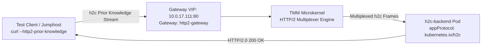

---

### `bigip-cis` Demo (VIP `.120`)
- **Objective**: Demonstrates the traditional ingress pattern (in-cluster CIS controller + external BIG-IP Virtual Edition appliance) in contrast to BNK's modern in-cluster TMM Gateway API.
- **Traffic Path**: Client $\to$ External BIG-IP VE VIP (`10.0.17.120`) $\to$ Shared backend pods.
- **Validation**: CIS reconciles `VirtualServer` CRD and routes traffic through the external BIG-IP appliance.

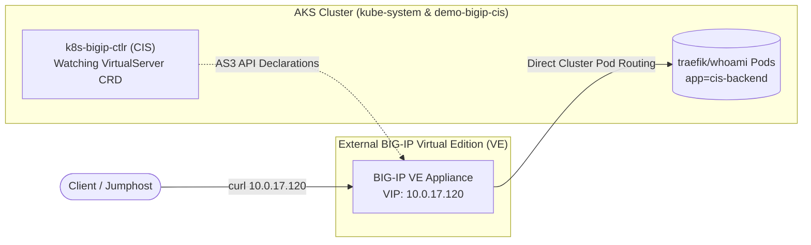

---

### `ingress-migration` Demo (VIP `.113`)
- **Objective**: Demonstrates zero-downtime migration to BNK Gateway API by running three ingress controllers simultaneously in front of ONE shared backend.
- **Traffic Path**: Client curls each ingress path using distinct host headers:
  - BNK Gateway (`web.bnk.migration.local` on VIP `10.0.17.113`)
  - NGINX Ingress (`web.nginx.migration.local` on ClusterIP)
  - HAProxy Ingress (`web.haproxy.migration.local` on ClusterIP)
- **Validation**: All 3 paths return HTTP 200 with the backend `Hostname` marker.

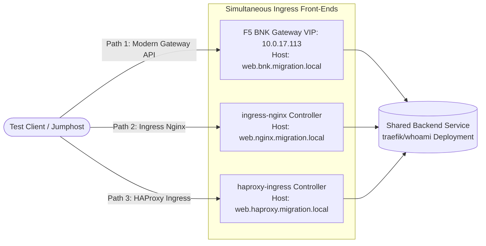

---

## 7. Where Each Scenario & Demo Runs

All 15 scenarios and demos can be run across the deployable configurations:

| Scenario / Demo | Needs Jumphost | Needs GPU Node | Prerequisites / Notes | Runs On |
|---|:---:|:---:|---|---|
| `http-routing-e2e` | Yes | – | Owns default cluster VIP (`.100`) | All examples |
| `http-traffic-split` | Yes | – | Owns VIP `.101` | All examples |
| `external-resource-pool` | Yes | – | Uses external IP target (VIP `.102`) | All examples |
| `proxy-protocol-l4` | Yes | – | Owns VIP `.103` | All examples |
| `tcp-l4-loadbalance` | Yes | – | Owns VIP `.106` | All examples |
| `udp-l4-loadbalance` | – | – | Amber: control plane only (VIP `.107`) | All examples |
| `grpc-loadbalance` | – | – | Amber: control plane only (VIP `.108`) | All examples |
| `multi-vip` | Yes | – | Pool `.115`–`.117` | All examples |
| `cluster-wide-watch` | Yes | – | Dynamic tenant namespace (VIP `.105`) | All examples |
| `cwc-admin-access` | – | – | In-cluster probe (no VIP) | All examples |
| `ai-token-counting` | – | – | Amber: control plane only without LLM (VIP `.104`) | All examples; data path on `demo-ai` |
| `ai-semantic-cache` | (probe) | – | Amber: control plane only without ModelCache (VIP `.109`) | All examples |
| `ai-inference-e2e` | Yes | **Yes** | GPU node pool; `--synthetic` runs on CPU (VIP `.112`) | `demo-ai` (real); others with `--synthetic` |
| `egress-snat` | (proof) | – | SNAT data path proven via counters | All examples; real on `dual-interface` |
| `core-file-collection` | – | – | Rolls TMM pods; run **last** (no VIP) | All examples |
| `agentfoundry-demo` | Yes | – | Azure AI Foundry + FastMCP tool (VIP `.150`) | `examples/agentfoundry-demo` |
| `diameter` | Yes | – | Demo mode; Diameter CER/CEA handshake (VIP `.110`) | Curated demo |
| `http2` | Yes | – | Demo mode; h2c wire multiplexing (VIP `.111`) | Curated demo |
| `bigip-cis` | Yes | – | Needs external BIG-IP VE appliance (VIP `.120`) | `full-cluster` with BIG-IP VE |
| `ingress-migration` | Yes | – | Installs Nginx & HAProxy controllers (VIP `.113`) | Curated demo |

---

## 8. VIP Address Allocation Plan

Every scenario and demo owns one deterministic last octet in the external data-path subnet (`network.subnets.external`, default `10.0.17.0/24`):

| Last Octet | Allocated Address | Owner | Kind |
|:---:|---|---|---|
| `.100` | `10.0.17.100` | `http-routing-e2e` (cluster default) | Scenario |
| `.101` | `10.0.17.101` | `http-traffic-split` | Scenario |
| `.102` | `10.0.17.102` | `external-resource-pool` | Scenario |
| `.103` | `10.0.17.103` | `proxy-protocol-l4` | Scenario |
| `.104` | `10.0.17.104` | `ai-token-counting` | Scenario |
| `.105` | `10.0.17.105` | `cluster-wide-watch` (CWC) | Scenario |
| `.106` | `10.0.17.106` | `tcp-l4-loadbalance` | Scenario |
| `.107` | `10.0.17.107` | `udp-l4-loadbalance` | Scenario |
| `.108` | `10.0.17.108` | `grpc-loadbalance` | Scenario |
| `.109` | `10.0.17.109` | `ai-semantic-cache` | Scenario |
| `.110` | `10.0.17.110` | `diameter` | Demo |
| `.111` | `10.0.17.111` | `http2` | Demo |
| `.112` | `10.0.17.112` | `ai-inference-e2e` | Scenario |
| `.113` | `10.0.17.113` | `ingress-migration` | Demo |
| `.115`–`.117` | `10.0.17.115`–`.117` | `multi-vip` (VIP A `.115`, VIP B `.116`, pool end `.117`) | Scenario |
| `.120` | `10.0.17.120` | `bigip-cis` (BIG-IP VE virtual server) | Demo |
| `.121`–`.123` | `10.0.17.121`–`.123` | `local-zone` reference manifests (SCTP, Diameter, HTTP/2) | Example |
| `.130` | `10.0.17.130` | `demo-ai` proxy shootout | Example |
| `.150` | `10.0.17.150` | `agentfoundry-demo` Gateway (`gateway-deployment.yaml`) | Example / Demo |
| `.200` | `10.0.17.200` | Jumphost / Client External Data Interface | Infrastructure |
| `.224`–`.254` | `10.0.17.224`–`.254` | TMM External Self-IP Pool (/27 allocated via F5 IPAM) | Infrastructure |

> [!NOTE]
> `cwc-admin-access`, `core-file-collection`, and `egress-snat` do not allocate external VIPs.
